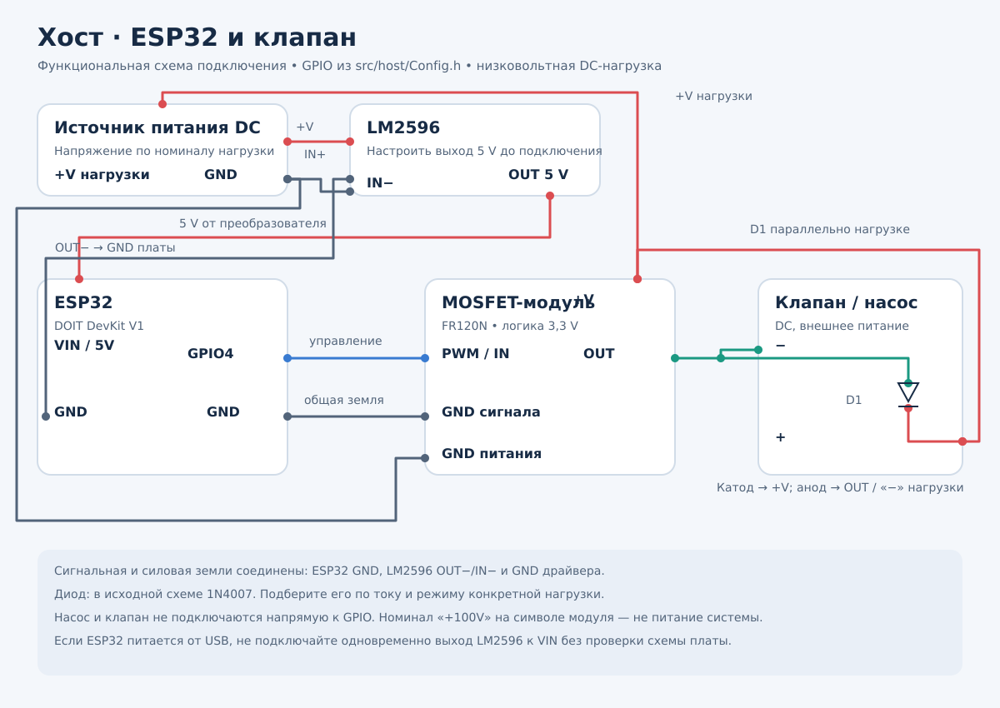
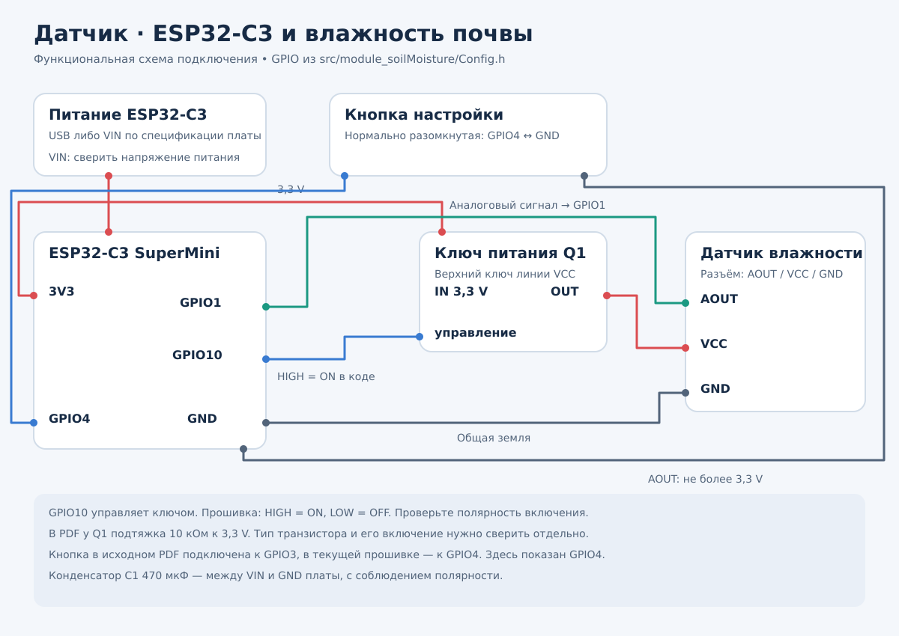

# AutoWateringSys

Система автоматического полива растений на ESP32. Датчики измеряют влажность
почвы и передают показания центральному контроллеру по ESP-NOW. Контроллер
управляет насосом или клапаном, а локальный веб-интерфейс позволяет настраивать
систему без подключения к интернету.

## Как работает

- **Хост — ESP32 DOIT DevKit V1:** принимает показания, включает полив по нижнему
  порогу и останавливает его при достижении верхнего порога или лимита времени.
  Между поливами выдерживается пауза.
- **Датчик — ESP32-C3 SuperMini:** измеряет влажность, отправляет её хосту
  и уходит в глубокий сон для экономии энергии.
- **Веб-интерфейс:** просмотр устройств и показаний, настройка порогов,
  калибровка и ручное управление поливом.

Настройки сохраняются в NVS. На модуле датчика используется RTC-кэш,
сохраняющий данные между пробуждениями из глубокого сна.

## Сборка и загрузка

Открой проект в VS Code с расширением PlatformIO. Команды выполняются
из корня проекта в терминале **PlatformIO: New Terminal**.

Подключи хост по USB и загрузи прошивку и веб-интерфейс:

```sh
pio run -e host -t upload
pio run -e host -t uploadfs
```

Подключи модуль датчика и загрузи его прошивку и файлы конфигурации:

```sh
pio run -e module_soilMoisture -t upload
pio run -e module_soilMoisture -t uploadfs
```

Для сборки без загрузки: `pio run -e host` или
`pio run -e module_soilMoisture`. Если подключены несколько плат,
укажи порт через `--upload-port`.

Назначение GPIO находится в `src/host/Config.h` и
`src/module_soilMoisture/Config.h`. Насос или клапан подключается
через подходящий силовой драйвер, а не напрямую к GPIO.

## Подключение

Упрощённые схемы показывают соединения по текущим GPIO прошивки.
Подписи внутри блоков обозначают сигналы, а не физическое расположение выводов.

### Хост



### Датчик



У датчика есть расхождения с исходной электрической схемой: кнопка в PDF
подключена к GPIO3, в коде — к GPIO4. Также нужно сверить ключ Q1:
прошивка включает его уровнем HIGH, а подтяжка затвора в PDF указывает
на возможную другую полярность управления. Схема выше показывает требуемые
сигналы, но не заменяет проверку конкретного транзистора и платы.

## Первый запуск

1. Включи хост и датчик. Новый датчик автоматически переходит в режим сопряжения.
2. Подключись к Wi-Fi **AutoWateringHost**, пароль **waterplants**.
3. Открой [страницу управления](http://192.168.4.1/).
4. Подключи обнаруженный датчик, выполни калибровку и настрой пороги,
   длительность полива и паузу.

Имя сети и пароль можно изменить в `src/host/Config.h`.
Для диагностики доступен Serial Monitor со скоростью **115200 бод**.

## Структура проекта

| Каталог | Содержимое |
| --- | --- |
| `src/host` | Прошивка хоста и управление поливом |
| `src/host/data` | Веб-интерфейс, загружаемый в LittleFS |
| `src/module_soilMoisture` | Прошивка датчика |
| `lib` | Общие библиотеки: сеть, хранение, логирование |
| `test` | Unit-тесты и интеграционные тесты |
| `docs`, `postman` | Документация и примеры API-запросов |

## Тесты и документация

Unit-тесты запускаются на компьютере:

```sh
pio test -e native
```

Покрытие тестами: `python3 scripts/coverage.py`.
Отчёт создаётся в `coverage/index.html`.

- [Как запускать тесты](test/README.md)
- [Калибровка датчика](docs/CALIBRATION.md)
- [Библиотека хранения](lib/Strorage/README.md)
- [Примеры API-запросов](postman/AutoWateringSys.postman_collection.json)

HTTP API принимает команды через `POST /api/command`,
события передаются через SSE: `GET /api/events`.
